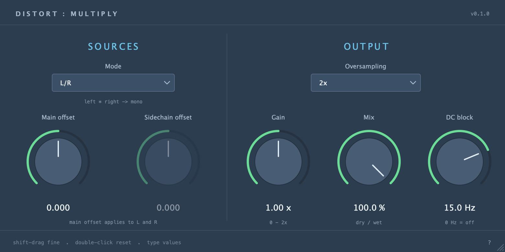

# DistMultiply

A C++20 JUCE effect that multiplies two incoming signals sample by sample.
Based on the project structure, routing, and visual style of DistInterleave.
Builds VST3, AU on macOS, and a custom standalone app with hardware sidechain routing.

[Download the latest release](https://github.com/silvansky/DistMultiply/releases/latest)



## Controls

| Control | Range | Default | Behavior |
| --- | --- | --- | --- |
| Mode | L/R, In/Sidechain | L/R | Selects the two sources. Mono main input always uses In/Sidechain. |
| Gain | 0–2x | 1x | Linear output gain after mixing. |
| Mix | 0–100% | 100% | Linear dry/wet blend. |
| Oversampling | 1x, 2x, 4x | 2x | Antialias filtering around the multiplier. |
| DC block | 0–20 Hz | 15 Hz | Final first-order high-pass filter; 0 Hz bypasses it. |
| Main offset | -1–1 | 0 | Adds DC to both main input channels before multiplication. |
| Sidechain offset | -1–1 | 0 | Adds DC to sidechain channels before multiplication. |

Gain, Mix, offsets, and DC cutoff changes ramp over 10 ms. Knobs support typed
values, double-click reset, and shift-drag fine adjustment. Hover controls for footer help, or the
question mark for audio configuration and version information. The editor resizes
with a fixed aspect ratio.

There are no Cycles, Channels, threshold, or silence-mode parameters.
Multiplication does not capture cycles or switch between sources.

## Signal routing

- **L/R:** `wet = (inputLeft + mainOffset) * (inputRight + mainOffset)`. The dry signal is
  `(inputLeft + inputRight) / 2`. Stereo output is identical on both channels at
  every Mix setting. A connected sidechain is ignored in this mode.
- **In/Sidechain:** `wetLeft = (inputLeft + mainOffset) * (sidechainLeft + sidechainOffset)` and
  `wetRight = (inputRight + mainOffset) * (sidechainRight + sidechainOffset)`. Processing is always independent per
  channel. The dry signal is the main input.
- Main input, sidechain, and output support mono/stereo independently. Mono
  sources are duplicated before multiplication; mono output averages the two
  processed channels. Mono main input forces In/Sidechain even if the host
  automates Mode to L/R.
- A disabled sidechain passes the main input through Gain, preserving the
  DistInterleave routing convention. An enabled silent sidechain produces zero
  wet signal when Sidechain offset is zero. The dry portion remains audible when
  Mix is below 100%.

Offsets affect only the multiplier; the dry signal retains its original DC level.
Sidechain offset is inactive in L/R mode. Both offsets are inactive when an
unconnected sidechain causes dry passthrough.

Before DC blocking, each output is `Gain * ((1 - Mix/100) * dry + (Mix/100) * wet)`.
At 2x/4x, polyphase IIR filters upsample the sources before multiplication and
filter the result before downsampling. The dry path shares these filters to
keep the blend aligned. All settings use the same small, host-reported latency,
including a matching delay at 1x, so automation never changes host compensation.
Changing Oversampling resets its resampling history. The final DC blocker acts
after downsampling, mixing, and Gain, including on dry passthrough.
There is no threshold, gate, clipping, saturation, normalization, or limiter.
Small signals are multiplied normally, and values above unity are preserved.
Processing reports no tail. The audio callback does not allocate storage, change
latency, or wait for cycle boundaries.

The plugin has its own identity (`Dmtp`, `com.silvansky.DistMultiply`) and state
root (`DistMultiplyState`), so it can coexist with DistInterleave. Its parameter
IDs are `mode`, `gain`, `mix`, `oversampling`, `dcBlock`, `mainOffset`, and
`sidechainOffset`. Earlier states retain their original controls and receive the
new controls' defaults.

## Build

Requires CMake 3.22+, a C++20 compiler, and the platform's JUCE build dependencies.
JUCE is pinned to commit `501c07674e1ad693085a7e7c398f205c2677f5da` and fetched
automatically, or use an existing checkout with `-DJUCE_SOURCE_DIR=/path/to/JUCE`.

```sh
cmake -S . -B build -DCMAKE_BUILD_TYPE=Release
cmake --build build --config Release --parallel 6
ctest --test-dir build -C Release --output-on-failure
```

On Windows, configure with `-A x64` when using the Visual Studio generator.
The GitHub Actions workflow builds universal macOS bundles and Windows x64
artifacts; version tags publish releases matching the CMake project version.

macOS outputs:

- `build/DistMultiply_artefacts/Release/AU/DistMultiply.component`
- `build/DistMultiply_artefacts/Release/VST3/DistMultiply.vst3`
- `build/DistMultiply_Standalone_artefacts/Release/DistMultiply.app`

Bundles are ad-hoc signed. Builds do not install plugins automatically. To install
and validate the AU in your user plugin directory, run `./install-au.sh --user`.
Use `--system` for the system plugin directory (requires administrator access).

## Standalone routing

Audio settings enables up to four hardware inputs and one or two outputs. The
routing menu maps the first active inputs to the main bus and the next inputs to
the sidechain: stereo L/R, mono + mono sidechain, mono + stereo sidechain,
stereo + mono sidechain, or stereo + stereo sidechain. Missing hardware channels
are silent. A separate output menu selects mono or stereo hardware output.

## Verification

Processor tests verify products and mixing against sample values across every
supported layout, including aliased mono-to-stereo sidechain storage, silence,
small signals, signs, values above unity, block-size independence, smoothing,
parameter defaults, offset routing, oversampling alias rejection, DC blocking,
and state restoration (including older sessions). On macOS the AU smoke test
loads the built bundle directly and verifies all eight enabled sidechain layouts at every
oversampling setting without installing it, checking exact products at 1x with
DC blocking bypassed.

```sh
cmake --build build --target DistMultiplyShot --parallel 6
./build/DistMultiplyShot docs/preview.png
./build/DistMultiplyShot docs/preview-mono.png mono
./build/DistMultiply_Standalone_artefacts/Release/DistMultiply.app/Contents/MacOS/DistMultiply --smoke-test
```

The standalone smoke test opens and closes the window without enabling hardware
audio. AU registration tests need access to macOS audio-component services.

## License

MIT; see [LICENSE.txt](LICENSE.txt). The LookAndFeel implementation is reused from
DistInterleave under the VarispeedDelay MIT option. JUCE and its dependencies
retain their own licenses and notices.
